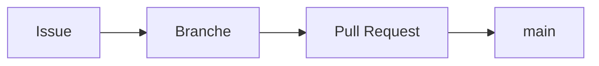

# 🧩 Module 13 — Tour des fonctionnalités GitHub

> ⏱️ **Durée** : 15 min\
> 🎯 **Objectif** : connaître les autres outils de GitHub pour savoir quoi utiliser selon le besoin.

---

## 1. 🐛 Issues, à fond

Au-delà d'un simple ticket, une issue s'organise avec :

| Élément | Usage |
|---|---|
| 🏷️ **Labels** | Catégoriser : `bug`, `enhancement`, `documentation`, `good first issue`… (*Issues → Labels*) |
| 👤 **Assignees** | Qui s'en occupe |
| 🎯 **Milestones** | Regrouper les issues d'une version (`v1.1.0`) avec barre d'avancement |
| 🔗 **Références** | `#12` lie une issue/PR, `@pseudo` notifie quelqu'un, un SHA de commit devient un lien |
| 🧵 **Sub-issues** | Découper une grosse issue en sous-tâches |

💡 Mentionnez `#1` dans un **message de commit** : le commit apparaîtra dans l'issue. `Fixes #1` dans un commit poussé sur `main` ferme l'issue.

### Modèles d'issues et de PR

Créez un dossier `.github/` à la racine du dépôt :

```text
.github/
├── ISSUE_TEMPLATE/
│   ├── bug.md                 ← formulaire "Signaler un bug"
│   └── fonctionnalite.md      ← formulaire "Proposer une idée"
└── pull_request_template.md   ← pré-remplit chaque nouvelle PR
```

Exemple de `.github/pull_request_template.md` :

```markdown
## Description

## Comment tester

## Checklist
- [ ] J'ai testé en local
- [ ] J'ai mis à jour le README si nécessaire

Closes #
```

💡 Le plus simple : *Settings du dépôt → General → Features → Issues → **Set up templates***.

---

## 2. 📋 Projects — tableaux Kanban

*Onglet **Projects** du profil ou du dépôt → New project → Board*

- Colonnes `Todo` / `In Progress` / `Done` personnalisables
- Les cartes sont des **issues et PR** : leur statut se met à jour automatiquement (PR fusionnée → `Done`)
- Vues tableau, tableau Kanban, feuille de route (*roadmap*), champs personnalisés (priorité, estimation…)

🧪 **TP** : créez un projet `Todo App`, ajoutez-y 3 issues, déplacez-les entre les colonnes.

---

## 3. 💬 Discussions et 📖 Wiki

| | 💬 Discussions | 📖 Wiki |
|---|---|---|
| C'est quoi | Un forum : questions, idées, annonces | Documentation en pages Markdown |
| Activation | *Settings → General → Features* | *Settings → General → Features* |
| Quand l'utiliser | Échanges qui ne sont pas des tâches | Doc longue, séparée du code |

💡 Beaucoup de projets préfèrent une documentation **dans le dépôt** (`docs/`, README) : elle est versionnée et relue en PR avec le code.

---

## 4. ✍️ Markdown à la sauce GitHub

GitHub enrichit le Markdown (*GFM : GitHub Flavored Markdown*), utilisable partout : README, issues, PR, commentaires.

````markdown
- [x] Tâche faite         ← cases à cocher
- [ ] Tâche à faire

| Col 1 | Col 2 |          ← tableaux
|-------|-------|
| a     | b     |

```python                ← code avec coloration
print("Bonjour")
```

> [!WARNING]             ← encadrés d'alerte (NOTE, TIP, IMPORTANT, WARNING, CAUTION)
> Ne pas supprimer ce fichier.



:rocket: :tada:          ← emojis
````

💡 Dans une zone de commentaire GitHub, onglet **Preview** pour voir le rendu.

---

## 5. 👤 README de profil

Un dépôt portant **exactement le même nom que votre pseudo** affiche son README sur votre page de profil. Votre vitrine ! ✨

🧪 **TP** :

1. **New repository** → nom : `votre-pseudo` → GitHub affiche *« ✨ You found a secret! »*
2. Public, ✅ **Add a README** → Create
3. Éditez le README :

```markdown
# Bonjour, je suis Prénom 👋

- 💼 Développeur chez ...
- 🌱 J'apprends Git et GitHub
- 📫 Me contacter : ...
```

4. Ouvrez `https://github.com/votre-pseudo` 🎉

---

## 6. 📝 Gists

[gist.github.com](https://gist.github.com) : partager rapidement **un fichier ou un extrait de code**, public ou « secret » (non listé, mais accessible à qui a le lien). Chaque gist est un mini-dépôt Git qu'on peut cloner, avec historique des révisions.

---

## 7. 💻 Éditer dans le navigateur

| Outil | Accès | Usage |
|---|---|---|
| ✏️ Éditeur simple | Icône crayon sur un fichier | Correction rapide d'un fichier |
| 🌐 **github.dev** | Touche `.` sur un dépôt (ou remplacer `.com` par `.dev` dans l'URL) | VS Code dans le navigateur, modifs sur plusieurs fichiers, sans exécution |
| ☁️ **Codespaces** | *Code ▾ → Codespaces* | Une vraie machine de développement dans le cloud, avec terminal. Quota mensuel gratuit, puis payant |

---

## 8. 🌍 GitHub Pages

Hébergement **gratuit** de sites statiques (HTML, documentation) directement depuis un dépôt public :
*Settings → Pages → Source : Deploy from a branch → `main` / `/ (root)`* → site publié sur `https://pseudo.github.io/depot/`.

---

## 9. 📊 Insights

*Onglet **Insights*** du dépôt :

- **Contributors** : qui contribue, combien
- **Network** : le graphe des branches et des forks, la version web de `git log --graph`
- **Traffic** : vues et clones (propriétaires uniquement)

---

## 10. 🔒 Sécurité

| Fonction | Ce qu'elle fait | Où |
|---|---|---|
| 🤖 **Dependabot alerts** | Alerte quand une dépendance (ex. `requirements.txt`) a une faille connue | *Settings → Advanced Security* |
| 🔄 **Dependabot updates** | Ouvre automatiquement des PR de mise à jour des dépendances | idem |
| 🕵️ **Secret scanning / Push protection** | Détecte les clés d'API et **bloque le push** contenant un secret | idem (actif par défaut sur les dépôts publics) |
| 📄 **SECURITY.md** | Indique comment signaler une faille de façon responsable | Fichier à la racine ou dans `.github/` |
| 👮 **CODEOWNERS** | Désigne automatiquement les relecteurs selon les fichiers modifiés | Fichier `.github/CODEOWNERS` |

Exemple de `.github/CODEOWNERS` :

```text
# Toute modification de la doc est relue par @alice
*.md        @alice
# Le code Python par @bob
*.py        @bob
```

⚠️ **Rappel** : si un secret a été poussé, même supprimé ensuite, il reste dans l'**historique**. Considérez-le comme compromis : **révoquez-le** immédiatement.

---

## 11. 🔔 Notifications, Watch et Star

- 👁 **Watch** un dépôt : *Participating* (par défaut), *All activity*, ou *Custom* (releases uniquement, par exemple)
- 🔔 [github.com/notifications](https://github.com/notifications) : la boîte de réception centralisée
- ⭐ **Star** : favoris (retrouvez-les sur votre profil → *Stars*)

---

## 12. 🏢 Organisations et équipes

Une **organisation** (ex. `github.com/ops-nc`) possède les dépôts d'une structure, indépendamment des personnes :

- Membres répartis en **équipes** (`@ops-nc/dev`, `@ops-nc/ops`) avec des droits par dépôt : *Read, Triage, Write, Maintain, Admin*
- Un départ = on retire la personne de l'organisation, les dépôts restent
- Les équipes peuvent être mentionnées et utilisées dans `CODEOWNERS`

---

## 📝 À retenir

| Besoin | Outil GitHub |
|---|---|
| Suivre un bug, une tâche | Issues (+ labels, milestones) |
| Piloter l'avancement | Projects |
| Échanger, poser des questions | Discussions |
| Partager un extrait de code | Gist |
| Se présenter | README de profil |
| Modifier vite fait | github.dev (touche `.`) |
| Publier un site statique | GitHub Pages |
| Sécuriser | Dependabot, push protection, CODEOWNERS |

---

⬅️ Précédent : [Module 12 — Tags et Releases](12-tags-et-releases.md) · ➡️ Suite : [Module 14 — Outils graphiques sous Windows](14-outils-graphiques-windows.md)
